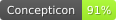
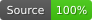
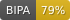

# Languages of Borneo

## How to cite

If you use these data please cite
- the original source
  > Smith, Alexander. 2017. The Languages of Borneo: A comprehensive classification. PhD thesis. University of Hawai'i at Mānoa.
- the derived dataset using the DOI of the [particular released version](../../releases/) you were using

## Description

This dataset is licensed under a CC-BY-4.0 license

Conceptlists in Concepticon:
- [Smith-2017-679](https://concepticon.clld.org/contributions/Smith-2017-679)
## Notes

# borneo
Lexibankify Bornean languages 

Cite the source dataset as

> Smith, Alexander. 2017. The Languages of Borneo: A comprehensive classification. (Doctoral dissertation, University of Hawai'i at Mānoa; 723pp.)

This dataset is licensed under a https://creativecommons.org/licenses/by-nc/4.0/ license

## Statistics

- **Varieties:** 95 (linked to 93 different Glottocodes)
- **Concepts:** 679 (linked to 609 different Concepticon concept sets)
- **Lexemes:** 50,997
- **Sources:** 1
- **Synonymy:** 1.05
- **Cognacy:** 50,997 cognates in 8,971 cognate sets (4,026 singletons)
- **Cognate Diversity:** 0.16
- **Invalid lexemes:** 0
- **Tokens:** 276,390
- **Segments:** 178 (38 BIPA errors, 38 CLTS sound class errors, 139 CLTS modified)
- **Inventory size (avg):** 35.74

## Possible Improvements:

- Languages missing glottocodes: 1/95 (1.05%%)

# Contributors

Name               | GitHub user | Role 
---                | ---         | ---
Johann-Mattis List | @LinguList  | maintainer
Taraka Rama | @phylostar | maintainer

## CLDF Datasets

The following CLDF datasets are available in [cldf](cldf):

- CLDF [Wordlist](https://github.com/cldf/cldf/tree/master/modules/Wordlist) at [cldf/cldf-metadata.json](cldf/cldf-metadata.json)